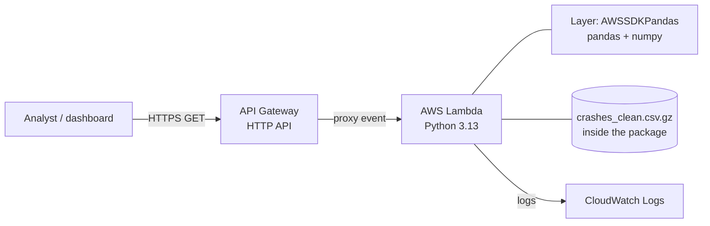

# TxDOT Crash Analytics API

data app built from TxDOT CRIS crash records for the Lubbock District, covering 24,261 crashes from 2020–2026. It cleans the data, calculates crash metrics, and provides a REST API deployed on AWS Lambda and API Gateway.

- **Live API:** https://gaixdi7436.execute-api.us-east-1.amazonaws.com
- **Interactive docs:** https://gaixdi7436.execute-api.us-east-1.amazonaws.com/docs
- **Frontend Dashboard:** https://gaixdi7436.execute-api.us-east-1.amazonaws.com/dashboard

## API

All endpoints use `GET` requests and return JSON. The same filters can be used across the metric endpoints, so the results can be narrowed down by county, year, severity, or road class.

| Endpoint | Description |
|---|---|
| `/health` | Checks that the API is running and shows how many crashes are loaded |
| `/meta` | Returns the available counties, years, severities, road classes, and date range. The dashboard uses these values for its dropdowns |
| `/severity` | Returns crash counts and percentages for K, A, B, and C |
| `/factors/top?n=5` | Returns the most common contributing factors. `n` can be between 1 and 25 |
| `/trends?group_by=year` | Groups crashes by year, month, weekday, or hour |
| `/crashes?limit=100&offset=0&with_coords_only=true` | Returns crash records in pages, including coordinates and contributing factors for the map |

**Filters:** `county`, `year`, `severity` (K, A, B, or C), and `road_class` are all optional. Filter values are not case-sensitive. If an invalid value is entered, the API returns a `422` error and shows the valid options.

For example, `/severity?year=2023` returns:

```json
{
  "filters": {"year": 2023},
  "total": 3673,
  "data": [
    {"severity": "K", "label": "Fatal injury", "crashes": 103, "pct": 2.8},
    {"severity": "A", "label": "Suspected serious injury", "crashes": 216, "pct": 5.9},
    {"severity": "B", "label": "Suspected minor injury", "crashes": 1122, "pct": 30.5},
    {"severity": "C", "label": "Possible injury", "crashes": 2232, "pct": 60.8}
  ]
}
```

The `filters` field shows which filters were used for the request, making it clear which subset of the data the response represents.

## Project Structure

| File / Folder | Description |
|---|---|
| `processing.py` | Loads and cleans the crash data and calculates the main metrics |
| `prepare_data.py` | Converts the raw CSV into the cleaned dataset |
| `api.py` | FastAPI application with the project endpoints |
| `lambda_handler.py` | AWS Lambda entry point using Mangum |
| `build_lambda.py` | Creates the Lambda deployment package |
| `data/crashes_clean.csv.gz` | Cleaned crash data with one row per crash |
| `dashboard.html` | Optional dashboard with charts and a crash map |
| `EDA.ipynb` | Notebook used for the exploratory data analysis |
| `README.ipynb` | Notebook with an overview and instructions for the project |
| `requirements.txt` | Dependencies used when running the project locally |
| `requirements-lambda.txt` | Dependencies included in the Lambda package; pandas is provided through a Lambda layer |

## Run locally

Python 3.10 or newer is required. The deployed Lambda uses Python 3.13.

```bash
git clone https://github.com/jose2122005-cmd/Coding-Assessment.git
cd Coding-Assessment
pip install -r requirements.txt
python -m uvicorn api:app --reload
```

Open `http://127.0.0.1:8000/docs` to view the API documentation.

The cleaned dataset is already included in the repository as `data/crashes_clean.csv.gz`, so the API can be run without the original CSV.

On Windows, use `py` instead of `python` and `py -m pip` instead of `pip` if those commands are not available directly.

### Regenerating the data

If the cleaning process needs to be changed or the cleaned file needs to be rebuilt, place the original `district_crashes.csv` in the project root and run:

```bash
python processing.py
python prepare_data.py
```

The first command prints a summary of the processed data. The second command creates a new `data/crashes_clean.csv.gz` file.

The original `district_crashes.csv` is not included in Git because it is about 77 MB.

### Environment variables

No environment variables are required. The project does not use API keys, secrets, or AWS credentials.

## Deployment on AWS

### Architecture



### Services used and why

| Service | Role | Why this one |
|---|---|---|
| **AWS Lambda** (Python 3.13, 1024 MB, 30 s timeout) | Runs the FastAPI app | There is no server running all the time, and I only pay when the function is used. This works well for a small API with a few analysts. |
| **Amazon API Gateway (HTTP API)** | Public HTTPS endpoint in front of Lambda | Provides the public URL and HTTPS connection. I used HTTP API instead of REST API because it is simpler and I do not need features such as API keys or usage plans for this project. |
| **Lambda layer `AWSSDKPandas-Python313`** | Provides pandas and numpy | pandas is too large to include easily in the deployment zip. The AWS-managed layer provides these packages without making the deployment package much larger. |
| **CloudWatch Logs** | Stores Lambda logs | Used to check requests and debug problems. |
| **IAM execution role** | Gives Lambda the permissions it needs | The function only needs permission to write logs, and the role handles this without putting AWS credentials in the code. |

These services are covered by the AWS Free Tier for this project. Lambda also includes a monthly free allowance of 1 million requests.

### How data flows

1. **Prepare the data:** `prepare_data.py` reads the original 77 MB CSV, applies the cleaning rules from [EDA.ipynb](EDA.ipynb), and creates `data/crashes_clean.csv.gz`. The cleaned file has one row per crash and is about 0.5 MB.
2. **Build the package:** `build_lambda.py` downloads the Linux versions of FastAPI and Mangum and packages them with the project code and cleaned data into `lambda_package.zip`.
3. **Deploy:** The zip file is uploaded to Lambda and the pandas layer is attached to the function.
4. **Handle a request:** API Gateway sends the HTTP request to Lambda. Mangum converts the request into a format FastAPI can use. The API then filters the DataFrame, calculates the requested result, and returns the response as JSON.
5. **Cold starts:** When Lambda starts a new container, the cleaned data is loaded into memory. The `lru_cache` keeps the DataFrame available for later requests handled by the same container.

### Why the data is included in the deployment package

The cleaned dataset contains 24,261 rows and is only about 0.5 MB when compressed. Because it is a small, static dataset, I decided to include it directly in the Lambda package instead of adding S3 or a database.

This keeps the deployment simple and avoids extra storage services and permissions. It also means Lambda does not have to process the original 77 MB CSV when it starts.

The main downside is that the API has to be redeployed whenever the dataset is updated.

### Alternatives considered

- **EC2:** This would work with a normal uvicorn server, but the instance would run continuously and would require OS updates and security configuration.
- **Containers (ECS/Fargate, App Runner, or a Lambda container image):** These would give more control over dependencies, but they add more setup than needed for this small API.
- **S3 + DynamoDB/RDS:** These would make more sense if the dataset were much larger or changed frequently. For this 0.5 MB static dataset, they would add unnecessary complexity.

### Deploying an update

Changes made locally do not automatically change the deployed API. The Lambda function has its own copy of the code and data.

```bash
python prepare_data.py        # only if a cleaning rule changed
python build_lambda.py        # creates lambda_package.zip

# AWS console:
# Lambda > crash-api > Code > Upload from > .zip file > Save

git add .
git commit -m "..."
git push
```

The Lambda handler is `lambda_handler.handler`.

API Gateway uses the following routes:

- `ANY /{proxy+}`
- `ANY /`

Both routes are connected to the Lambda function. The API uses the `$default` stage with auto-deploy enabled.

## Design notes

- **Crash-level metrics.** The original data has one row per person, so the analysis counts crashes after removing duplicate crash records. The final dataset contains 24,261 crashes, which matches the count in the file header.
- **Contributing factors.** Factors are separated using `;` and each factor is counted once per crash. Because a crash can have multiple factors, the percentages do not necessarily add up to 100%.
- **Separate processing and API code.** The data processing in `processing.py` does not depend on the web API. The same functions are used by the API, the data preparation script, and the command-line summary.
- **Filter validation.** Severity and road class values are checked against the values in the dataset. This way, a typo gives an error instead of returning zero crashes and making it look like there were no matching records.

## Known limitations and what I would improve

- **No authentication or rate limiting.** The API is public, which is fine for this crash data but would not be appropriate for sensitive information. For a larger deployment, I would add API Gateway throttling and either an authorizer or usage plan. This would also help prevent excessive requests from using the available AWS allowance.

- **Manual deployment.** Updates currently require rebuilding the zip file and uploading it manually. A future improvement would be to use AWS SAM or Terraform and a GitHub Actions workflow to build and deploy automatically.

- **Static data.** Adding a new CRIS extract requires running the preparation script and deploying the API again. If the dataset becomes larger or needs to be updated more often, storing the data in S3 would make more sense.

- **Cold starts.** The first request after the Lambda function has been idle can take longer because pandas and the dataset need to be loaded. Provisioned concurrency could reduce this delay, but it would add cost. Keeping the package small and loading only the 9 required columns already helps.

- **pandas version differences.** The AWS layer provides its own pandas version, which may be different from the version used locally. I checked the main metrics using the deployed API, but a future version could pin the dependencies or use a container image to make the environments match exactly.

- **No automated tests.** The results were checked manually against the source totals and severity counts in `EDA.ipynb`. I would add unit tests for the cleaning rules and API tests for the main endpoints.

- **No CORS configuration.** A dashboard hosted on a different domain would be blocked by the browser until CORS is enabled.

- **Offset-based pagination.** The API sorts the data on each request and uses offsets for pagination. This is fine for the current dataset, but cursor-based pagination would be better if the dataset becomes much larger.

- **Data caveats.** 849 crashes (3.5%) do not have coordinates, and 2026 is only a partial year through October 20. All metrics count crashes rather than individual people. More details are available in [EDA.ipynb](EDA.ipynb).

## Bonus: dashboard

Live at `/dashboard` ([AWS API Gateway](https://gaixdi7436.execute-api.us-east-1.amazonaws.com/dashboard)).

The dashboard is a single HTML page that uses the API's endpoints to show:

- Year and county filters
- Crash severity chart
- Trend chart by year, month, weekday, or hour
- Top contributing factors
- A map of fatal (K) and serious-injury (A) crashes, with popups showing the date, road class, and contributing factors

- **Why it is served by the same Lambda:** This avoids adding another AWS service just to host the page. Since the dashboard and API use the same origin, CORS is not needed. For a production application, I would move the frontend to S3 and serve it through CloudFront.

- **Why the map only shows K and A crashes:** These are the most serious crashes and would be the first ones a safety analyst would normally review. There are about 2,200 of these points, which is still manageable for the map. Showing all 24,000 crashes would likely require clustering or a heatmap.

- **Limitations:** Chart.js, Leaflet, and the OpenStreetMap tiles are loaded from public CDNs, so the dashboard needs an internet connection. The map requests crashes in pages of 1,000 records. Crashes without valid coordinates (3.5%) cannot be shown on the map.


```python

```
